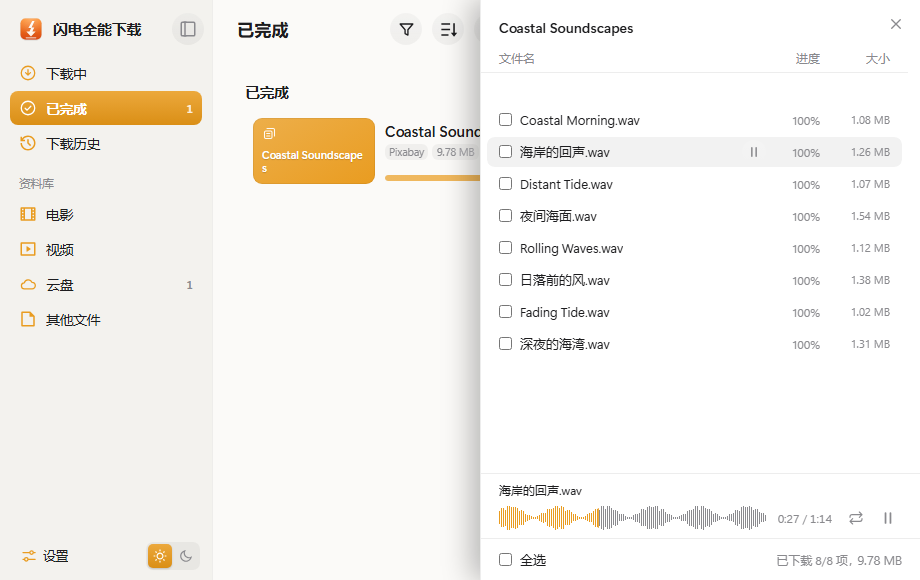
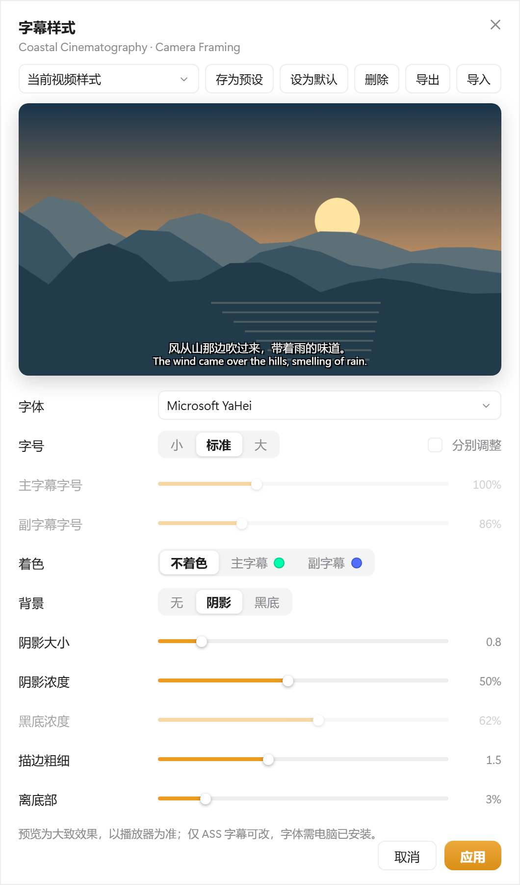

# 闪电全能下载 · Windows 版

**下载文件、网盘资源和视频合集，下载后还能处理字幕和试听音频。**

**[下载 Windows 版](https://github.com/cgeek-dev/shandian-download/releases/latest)**　·　[下载 macOS 版](https://github.com/chenmozhe008/shandian-download/releases/latest)　·　[界面展示](#界面展示)　·　[播放与字幕](#播放与字幕)　·　[下载来源](#能下载什么)　·　[安装与更新](#安装与更新)　·　[版本记录](windows/CHANGELOG.md)

## 界面展示

### 下载队列

直链、网盘文件和视频合集在同一个窗口管理。任务卡片显示来源、进度和速度，支持暂停和继续。

  

### 合集文件抽屉

点开合集可看每个文件的封面、进度、大小和字幕。用 Ctrl、Shift 或框选选择多个文件，再从右键菜单执行可用操作。

  
   两张截图均使用演示任务

## 播放与字幕

| 功能 | 怎么用 |
| --- | --- |
| **补齐合集字幕** | 新建视频下载时选字幕语言。已完成的合集可一键补齐缺失字幕，也可在抽屉里多选分集，按需重新获取。 |
| **调整字幕样式** | 点击已完成任务的字幕标记，边预览边调中英字幕字号、字体、颜色、描边、背景和离底部的距离。可以保存、导入或导出预设，也可以给多个视频统一套用。可将支持的 SRT、VTT 转成 ASS 并保留原件。 |
| **本地 AI 润色与翻译** | 在「设置」选好本机 Ollama 模型后，可给已有字幕润色，或把仅有的英文字幕翻译成中文。支持对选中的分集批量处理，也可恢复原字幕。 |
| **本地音频试听** | 在已完成任务的文件抽屉点播放，查看波形、当前进度和总时长，拖动进度定位。支持单曲播放、单曲循环、顺序播放、列表循环与随机播放。 |
| **视频播放** | 点击卡片或分集的播放按钮，用本机播放器打开已下载的视频。支持的种子或磁力任务也能边下边播。 |

### 文件抽屉内试听

  

### 字幕样式与预览

  
   截图使用演示任务

## 安装与更新

| 版本 | 怎么用 |
| --- | --- |
| **安装版** | 运行发布页的 `setup.exe`。安装后在「设置 → 关于」可检查和安装更新，发现新版时右下角也会提示。 |
| **便携版** | 完整解压 ZIP，再运行「闪电全能下载.exe」。从发布页获取新版，包内附有清理本机闪电数据的工具。 |
| **浏览器扩展** | 在「设置 → 浏览器扩展」打开随包目录，按提示在 Chrome 或 Edge 加载。Windows 只接入随包扩展，商店版无法连接。 |

## 能下载什么

| 来源 | 使用方式 |
| --- | --- |
| **文件和种子** | 粘贴 HTTP/HTTPS、磁力或 ed2k 链接，也可以把 `.torrent` 种子文件直接拖进闪电主窗口。下载中可看速度和分文件进度，按需暂停或继续。 |
| **视频和合集** | 支持 YouTube、哔哩哔哩、抖音、小红书、快手、微博、西瓜视频、Vimeo、X、新片场等来源。YouTube 和哔哩哔哩可选分集，支持的资源可下载字幕。 |
| **素材和文档** | 在 Pixabay、爱给查找素材并勾选批量下载，爱给可先试听支持的音频。轻雀文档可批量选择附件，飞书原件下载依赖账号和文档权限。 |
| **网盘里的文件** | 百度网盘、夸克、UC、阿里云盘、123 云盘、天翼、移动、迅雷和光鸭等提供网页入口。在网盘里选好文件，再用扩展交给闪电。 |
| **百度网盘分享** | 直接提交分享链接，按提示授权并选择可下载的文件。使用转存方式时，可开启校验后清理本次网盘转存。 |
| **网页音视频和字幕** | 扩展可接管浏览器下载、提供悬停下载按钮，也可扫描当前网页的链接、音视频和字幕。资源播放时才出现的，可以开启当前标签页的播放侦测。 |
| **软件和公开文件** | 可提交 GitHub、Hugging Face 等站点提供的下载地址，部分公开文件支持使用镜像加速。 |

具体下载入口和可用资源取决于站点、浏览器登录状态和文件权限。

## 管理下载

- **批量任务按一条管理。** 视频合集和网站批量文件可展开查看各项进度。支持多选、框选及右键批量操作，下载中、已完成和历史可查看对应任务。
- **下载前检查重复和同名。** 新建任务时可查看已有任务，保存位置有冲突时按提示选择处理方式。
- **继续已有下载。** 已暂停的下载可继续。部分网盘链接过期后可重新取链，确认对应原文件后接着下载。
- **控制下载节奏。** 可设置并发和下载限速。视频文件完成后会释放下载名额，后续字幕处理继续进行。
- **下载时保持唤醒。** 开启后有下载进行时阻止系统睡眠，下载空闲后释放。

## 用 AI 工具管理下载

在「设置 → AI 工具」复制 Codex 或通用 JSON 配置，把本机闪电接到支持 MCP 的工具。连接后可提交下载、查看进度、暂停和继续。

## 源码与许可证

Windows 源码在 `windows/`。桌面程序使用 **Rust / Tauri / WebView2**，随包扩展使用 **JavaScript**。下载内核使用 Gopeed，视频来源使用 yt-dlp 等工具。

[Windows 问题反馈](https://github.com/cgeek-dev/shandian-download/issues/new/choose) · [Windows 源码与构建](windows/README.md) · [已合并的 Windows PR](https://github.com/chenmozhe008/shandian-download/pull/2) · [GPL-3.0 许可证](LICENSE)
