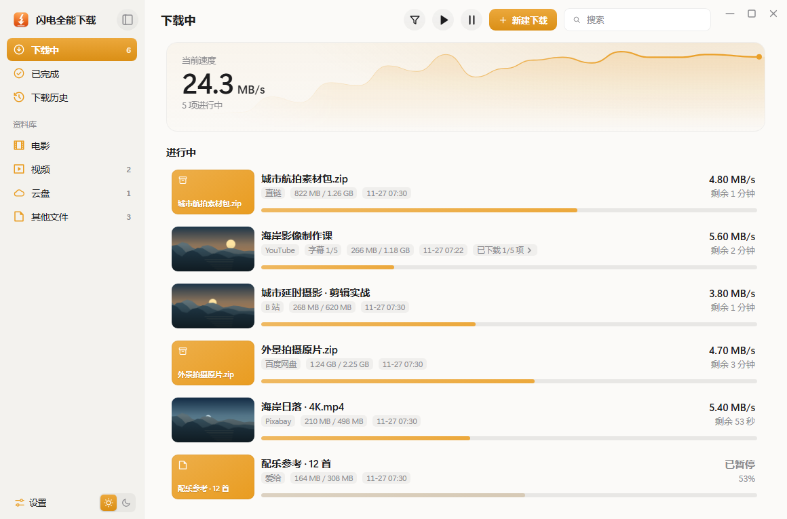
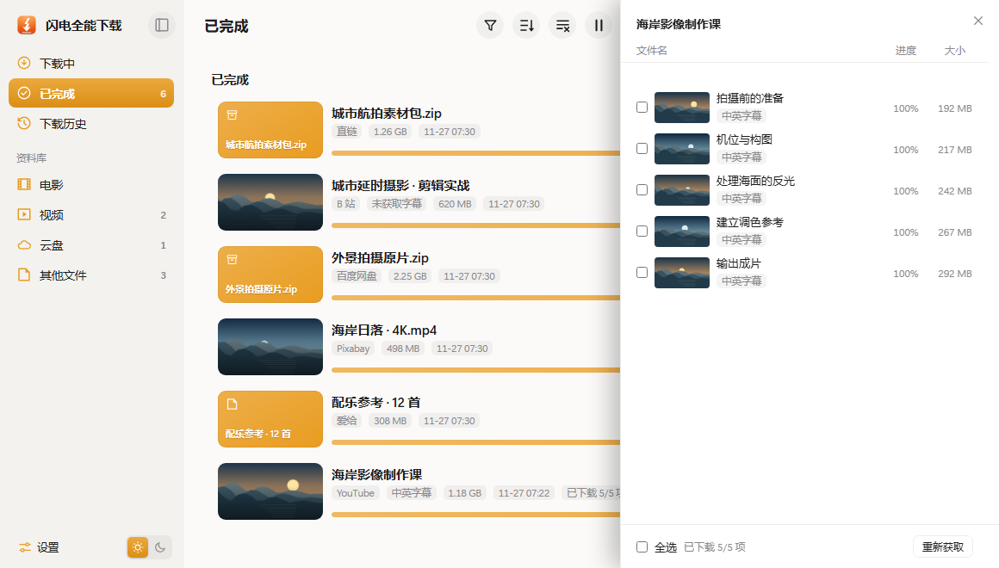

# 闪电全能下载 · Windows 普通版

**用一个窗口管理文件、网盘和视频合集下载。**

**[下载 Windows 版](https://github.com/cgeek-dev/shandian-download/releases/latest)**　·　[安装与更新](#安装与更新)　·　[版本记录](windows/CHANGELOG.md)

已测试 Windows 10 / 11（x64） · 简体中文 · Chrome / Edge 扩展

Windows 0.2.15 · 下载队列，使用演示任务

## 安装与更新

| 版本 | 怎么用 |
| --- | --- |
| **安装版** | 运行发布页的 `setup.exe`。安装后在「设置 → 关于」可检查和安装更新，发现新版时右下角也会提示。 |
| **便携版** | 完整解压 ZIP，再运行「闪电全能下载.exe」。从发布页获取新版，包内附有清理本机闪电数据的工具。 |
| **浏览器扩展** | 在「设置 → 浏览器扩展」打开随包的扩展目录，按提示在 Chrome 或 Edge 加载。 |

## 能下载什么

| 来源 | 使用方式 |
| --- | --- |
| **文件和种子** | 粘贴 HTTP/HTTPS、磁力、ed2k 等链接，也可以添加种子文件。下载中可看速度和分文件进度，按需暂停或继续。 |
| **视频和合集** | 支持 YouTube、哔哩哔哩、抖音、小红书、快手、微博、西瓜视频、Vimeo、X、新片场等来源。YouTube 和哔哩哔哩可选分集，支持的资源可下载字幕。 |
| **素材和文档** | Pixabay、爱给可在扩展中查找素材。轻雀文档可批量选择附件，飞书原件下载依赖账号和文档权限。 |
| **网盘文件** | 百度网盘、夸克、UC、阿里云盘、123 云盘、天翼、移动、迅雷和光鸭等网页提供扩展入口。支持的直链过期后可以重新取链续传。 |
| **网页音视频** | 扩展可接管浏览器下载、提供悬停下载按钮、查找本页的链接、音视频和字幕。资源要到播放时才出现的，可以对当前标签页开启播放侦测。 |

具体下载入口和可用资源取决于站点、浏览器登录状态和文件权限。

<strong>查看文件抽屉与合集分集</strong>

 

点开合集可看每个文件的进度、大小和字幕。用 Ctrl、Shift 或框选选择文件，再从右键菜单执行可用的字幕或复制操作。

Windows 0.2.15 · 合集文件抽屉，使用演示任务

## 用 AI 工具管理下载

在「设置 → AI 工具」复制 Codex 或通用 JSON 配置，把本机闪电接到支持 MCP 的工具。连接后可提交下载、查看进度、暂停和继续。

## 源码与许可证

Windows 源码在 `windows/`。桌面程序使用 **Rust / Tauri / WebView2**，随包扩展使用 **JavaScript**。下载内核使用 Gopeed，视频来源使用 yt-dlp 等工具。

[Windows 源码与构建](windows/README.md) · [已合并的 Windows PR](https://github.com/chenmozhe008/shandian-download/pull/2) · [GPL-3.0 许可证](LICENSE)
